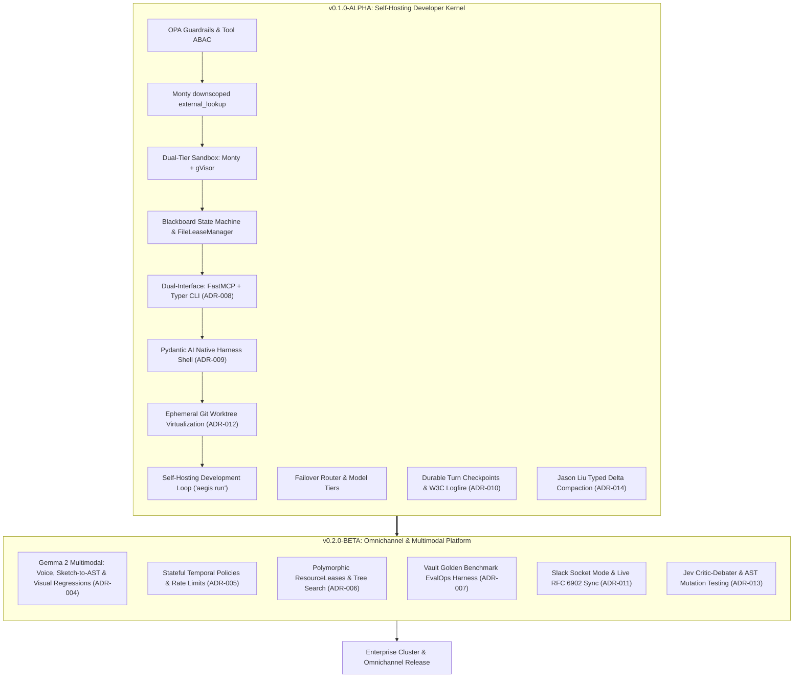

# Aegis MCP & InceptOS: Architectural Review & Gap Analysis (v0.1.0-Alpha)

**Document ID:** `ARCH-REVIEW-001`  
**Status:** RATIFIED  
**Date:** 2026-10-08  
**Scope:** Formal audit of `architecture/spec_v0-0-1-alpha.md` against operational invariants, existing production assets (`src/`), and enterprise threat models.

---

## 1. Executive Summary

`architecture/spec_v0-0-1-alpha.md` successfully establishes core agent execution governance:
- Dual-layer human inception via RFC 6902 JSON Patches (`InceptOS` $\leftrightarrow$ `Aegis Engine`).
- Monotonic state transitions on `TaskBlackboard`.
- Atomic in-memory `FileLeaseManager` with TTL eviction.
- Zero-external-dependency static AST analysis (`ASTProjector`) and Content-Addressed Storage (`BlobVault`).
- Welsh-Powell graph coloring DAG dispatch for non-conflicting parallel execution.

However, a critical review reveals **six major structural gaps and omission vectors** in the Alpha specification that would lead to security escapes, broken test benches, and regression of existing production features if implemented without remediation.

---

## 2. Core Gap Matrix: Spec vs. Production Reality

| Domain | Spec v0.1.0-Alpha Status | Production Gap / Risk | Architectural Remediation |
| :--- | :--- | :--- | :--- |
| **1. Policy Engine & ABAC** | **Section 5:** Covers filesystem containment, test locks, and forbidden imports (`subprocess`). | **Zero Tool Scoping or ABAC.** Omits actor scopes (`tools:execute`), agent tool whitelists, and argument-level bounds. | Merge filesystem guardrails with Tool ABAC into a unified dual-branch Rego policy. |
| **2. Monty "Code Mode" Scoping** | **Section 1 & 5:** Assumes Monty sandbox handles security via isolation alone. | **Unscoped Host Function Injection.** Injecting global catalog into `external_lookup` lets untrusted Python bypass ABAC. | Implement dynamic function downscoping in `worker.py` based on verified agent permissions. |
| **3. Sandbox Execution Topology** | **Section 1 & 2:** Dictates Monty Python/Rust sandbox as the sole execution engine. | **Blind to Native Test Runners.** Monty executes in-process bytecodes with no syscalls; cannot run `pytest`, `cargo`, or shell linters. | Retain dual-tier sandbox: Monty for fast in-process expressions + Ephemeral gVisor (`runsc`) for test suites. |
| **4. LLM Provider Resilience** | **Section 1 & 7:** Treats LLM completions as infallible black-box API calls. | **Vulnerable to 429 Rate Limits & Outages.** A single rate limit in a 25-turn TDD loop halts the pipeline without failover. | Wire existing `ModelFailoverRouter` (Gemini Flash $\rightarrow$ 32k $\rightarrow$ GPT-4o) with audit headers into Control Plane. |
| **5. Cross-Session Memory** | **Section 6:** Introduces flat Content-Addressed Storage (`BlobVault`) for raw diffs. | **No Semantic Episodic Memory.** Agents cannot recall successful patterns from previous solved tasks. | Retain PGVector store (`src/memory/store.py`) for cross-session episodic retrieval alongside in-session CAS blobs. |
| **6. Enterprise Identity Ingress** | **Section 3:** Assumes 4-tuple `AegisIdentityContext` arrives pre-formed. | **Lacks AuthN & Ingress Bridge.** No specification for upstream Envoy headers, Keycloak JWTs, or role mapping. | Formalize the ingress translation from Keycloak OIDC JWT claims to canonical `AgentCompositeKey` / `AegisUrn`. |
| **7. Subagent Capability Scoping & Context Typing** | **Section 9:** Raw FastMCP tool exposure without subagent inheritance boundaries or typed injection guards. | **Capability Leak & Broken Injection.** Subagents risk inheriting broad supervisor permissions; complex `Annotated`/`Union` type annotations break dynamic FastMCP schema parsing. | Adopt `SubagentSkillScoping` (allowlists/denylists) and unwrapped qualified context resolution in stub generator. |
| **8. Multi-Domain Generalization & Concurrency** | **Sections 4, 6, 7:** Hardcodes Python filesystem paths (`FileLease`), stdlib `ast`, and static conflict coloring. | **Domain Lock-In & Naive Scheduling.** Cannot govern non-code org agents (Finance, Legal, Ops); performs static mutex checks rather than speculative solution-space optimization. | Generalize `ResourceLease` URNs, pluggable `DomainVerifier` harnesses, and speculative tree search (ADR-006). |
| **9. Dual-Track Evals Architecture** | **Section 8:** Naive 4-parameter method (`evaluate_task(...)`) hardcoding Python/ruff exit codes. | **Missing EvalOps & Benchmark Harness.** Conflates inner-loop runtime task gating with offline agent capability benchmarking; lacks standardized dataset grading. | Unify runtime `GraderPipeline` with the CLI `vault` benchmark eval engine (`DeterministicVerifier`, `FormatSchema`, `Guardrail`, `SpecIntent`, `TelemetryBudget`). |
| **10. Dual-Interface Surface Architecture** | **Section 9:** Bare 4-tool snippet with zero command-line interface specifications. | **Interface Role Confusion & Blind Execution.** Fails to distinguish between autonomous LLM agent consumers (JSON-RPC) and human/CI operators (shell/POSIX); lacks lease release and targeted verifier tool primitives. | Partition into FastMCP Agent Gateway (7 tools across Concurrency, Context, Execution) and Typer Platform Cockpit (5 command groups: session, context, policy, eval, serve) (ADR-008). |
| **11. Pluggable Agent Harness Architecture** | **Section 1, 4, 7:** Treats inner agent loop as an abstract black box with mock steps in `src/orchestrator/runtime.py`. | **Harness Lock-In vs. Zero Governance.** Bespoke harnesses suffer high maintenance liability from LLM schema churn; "server-only" BYOH lacks out-of-the-box headless execution for CI/CD and unattended builds (`v build`). | Adopt "Kernel vs. Shell" topology: Aegis Control Plane as unbypassable zero-trust Kernel, Pydantic AI/LiteLLM as native headless Shell (`aegis run`), FastMCP as open external Shell (ADR-009). |
| **12. Durable Execution & Telemetry Continuity** | **Section 3 & 4:** Ephemeral in-memory queue without persistent checkpoints or replay. | **Catastrophic State Loss & Non-Idempotency.** Crashes on Turn 18/25 forfeit entire token budgets; spans lack distributed W3C `traceparent` propagation across async queues and sandboxes. | Event-sourced turn snapshots (`TaskCheckpointRecord`), tool-call memoization/replay keys, and mandatory unified Pydantic Logfire distributed tracing (ADR-010). |
| **13. Omnichannel Edge & Mobile Sync** | **Section 1 & 9:** Confined to local desktop IDE and terminal CLI surfaces. | **Desktop Siloing & Frozen HITL Escalations.** Mobile engineers cannot review diffs, approve escalations from Slack, or sync state smoothly with PC workstations. | Slack Socket Mode interactive Block Kit approval bot, SSE/WebSocket RFC 6902 JSON patch streams, and cross-device monotonic vector reconciliation (ADR-011). |
| **14. Workspace Isolation & Branch Hygiene** | **Section 4 & 5:** Mutates files directly in the developer's working directory. | **Working Directory Contamination & Race Conditions.** Multi-agent concurrent execution dirties human stashes, compiler caches, and active IDE files. | Ephemeral Git Worktree virtualization (`src/orchestrator/worktree.py`), branch sandboxing, and atomic fast-forward certification merges (ADR-012). |
| **15. Advanced Quality Gating & Anti-Fraud** | **Section 8:** Relies solely on deterministic exit codes and naive single-judge rubric scoring. | **Tautological Test Fraud & Sycophancy.** Agents write vacuous assertions (`assert True`) to pass TDD gates; single LLM judges miss subtle regressions. | LLM-assisted mutation testing (anti-tautology filter) and Critic-Debater multi-agent Jev arbitration (ADR-013). |
| **16. Jason Liu Context Engineering Rigor** | **Section 6:** Unstructured conversation truncation and naive summarization triggers. | **Semantic Information Loss & Prompt Bloat.** Free-form chat summarization loses exact variable types, negative constraints, and discovered invariants. | Jason Liu typed delta compaction (`SessionDistillation`), strict Pydantic v2 boundary extraction, and progressive AST disclosure (ADR-014). |

---

## 3. Deep Dive: The Core Omissions & Recommended Corrections

### Gap 1: OPA Policy Sufficiency & The Missing ABAC Layer
* **Deficiency in Spec (Section 5):** The Rego policy (`policies/aegis_guardrails.rego`) only evaluates actions `write_file`, `read_file`, and `exec_command`. It contains no logic for `call_tool`.
* **Vulnerability:** An agent unable to write to `blackboard.py` due to a file lease lock can simply call a tool like `execute_database_drop` or invoke tensor profiling with `matrix_dim = 1000000`, causing denial of service.
* **Correction Insight:** The Rego policy must evaluate a composite gate with two distinct branches:
  1. **Filesystem Gate:** Traversal check, exclusive lease matching, test modification lock, and AST import scanning.
  2. **Tool Invocation Gate (ABAC):** Verifies `tools:execute` scope, checks if `input.tool` is in `input.agent_authorized_tools`, and validates argument boundaries (e.g., `matrix_dim <= 8192`).

### Gap 2: Monty Function Scoping & Host Injection ("Code Mode")
* **Deficiency in Spec (Section 1 & 5):** The spec refers to the Monty Python/Rust engine without defining the capability boundary of host function injection.
* **Vulnerability:** Sam Colvin's core tenet for Monty is that in-process execution is only safe when external functions injected via `external_lookup` are strictly whitelisted. If the Data Plane exposes every tool in the catalog to Monty's execution namespace, an agent writing Python in "Code Mode" can execute tools that were never granted to its role.
* **Correction Insight:** `src/data_plane/worker.py` must filter the tools passed into Monty's `external_lookup` on *every execution*, matching only the subset authorized by the Control Plane's OPA decision. Unauthorized tool calls inside the sandbox must immediately raise a runtime `NameError`.

### Gap 3: The Single-Sandbox Fallacy (Monty vs. gVisor)
* **Deficiency in Spec (Section 2 & 8):** The spec lists Monty as the execution engine while Section 8 demands that `GraderPipeline` execute `pytest` and `ruff`.
* **Conflict:** Monty is an in-process Python bytecode interpreter with zero OS syscall capability. It physically cannot invoke `pytest`, run linter subprocesses, or execute binary test harnesses.
* **Correction Insight:** The architecture requires a **Dual-Tier Sandbox Engine**:
  * **Tier A (In-Process Monty):** Ultra-fast (<5ms), zero-syscall execution for safe math, data shaping, AST parsing, and scoped tool choreography.
  * **Tier B (Ephemeral gVisor Container):** Strong kernel boundary (`runsc`) with an isolated virtual filesystem for executing test suites (`pytest`), compilation (`cargo`), and package operations.

### Gap 4: LLM Failure Cascades & Missing Routing Tier
* **Deficiency in Spec (Section 3 & 4):** State machines limit turns (`turn_ceiling = 25`) and retries (`max_retries = 3`), but assume LLM inference is 100% reliable.
* **Vulnerability:** Autonomous TDD loops generate bursty token demands. A single 429 rate limit or 503 provider hiccup aborts the entire ticket, marking the session `BLOCKED` or `CANCELLED`.
* **Correction Insight:** Re-integrate the existing `src/control_plane/failover_router.py`. The Control Plane must transparently route completions through tiered fallbacks (`gemini-3.8-flash-8192` $\rightarrow$ `gemini-3.8-flash-32768` $\rightarrow$ `gpt-4o`) with exponential backoff and inject audit headers (`X-Aegis-Model-Served`, `X-Aegis-Failover-Triggered`) before the agent loop fails.

### Gap 5: Memory Architecture Bifurcation (Episodic vs. CAS)
* **Deficiency in Spec (Section 6):** The spec only provides `BlobVault` (a content-addressed SHA-256 CAS engine for raw byte slices).
* **Vulnerability:** Flat CAS allows an agent to retrieve file slices by hash, but gives zero semantic recall. The agent cannot search for prior solutions, test patterns, or architectural examples.
* **Correction Insight:** Explicitly partition memory into:
  * **L1 Artifact CAS (`src/context/blob_vault.py`):** In-session, deterministic file version snapshots, raw diffs, and AST representations referenced by `urn:aegis:blob:...`.
  * **L2 Semantic Episodic Store (`src/memory/store.py`):** Cross-session PGVector store indexing past execution episodes (`EpisodicMemoryRecord`) via cosine similarity.

### Gap 6: Identity Ingress & OIDC Claim Translation
* **Deficiency in Spec (Section 3):** The spec specifies `AegisIdentityContext` with strict regexes but provides no mechanism for how incoming HTTP requests acquire these credentials.
* **Vulnerability:** Either callers must self-assert their identity (violating zero-trust), or upstream proxies must inject untrusted headers.
* **Correction Insight:** Formalize the contract between `src/control_plane/oidc.py` and `src/control_plane/schemas.py`. Incoming requests from Envoy must validate Keycloak JWTs, extract claims (`sub`, `roles`, `groups`), and securely bind them into the immutable 4-tuple `AgentCompositeKey`.

### Gap 7: Subagent Capability Scoping & Qualified Tool Context Resolution
* **Deficiency in Spec (Section 9):** The spec defines MCP tool registration globally but omits subagent-level capability inheritance boundaries and clean typing resolution for injected host dependencies.
* **Vulnerability:**
  1. When orchestrator supervisors delegate work to specialized subagents (`@tdd-builder`, `@test-engineer`), there is no contract enforcing which tools the subagent can invoke. Subagents inherit the global tool catalog, violating least-privilege principles.
  2. Modern Python 3.12+ annotations such as `Annotated[UserContext | None, Depends(...)]` or `typing.Union` break dynamic reflection in `src/control_plane/stub_generator.py` and FastMCP argument parsers, causing internal server dependencies to leak into LLM-facing JSON schemas.
* **Correction Insight (Antigravity SDK Alignment):**
  1. Add `SubagentSkillScoping` to `AgentSpec` (`src/orchestrator/schemas.py`) with explicit `allowed_skills` and `denied_skills`. Wire this directly into OPA ABAC checks and Monty's `external_lookup` downscoping.
  2. Implement qualified context unwrapping in `src/control_plane/stub_generator.py` and `src/data_plane/dependencies.py` using `typing.get_origin()` and `typing.get_args()` to cleanly strip host dependency injection parameters from model-visible schemas.
  3. Add `register_lifecycle_hooks` on `TaskBlackboardManager` for batch registration of state machine listeners (Logfire telemetry, context health monitors, lease audits).

### Gap 8: Generalizing Beyond Software Agents (Polymorphic Leases & Verifiers)
* **Deficiency in Spec (Sections 4, 6, 7):** The spec couples the platform tightly to Python software engineering:
  1. `FileLease` assumes mutations only occur on filesystem paths.
  2. `ASTProjector` assumes Python syntax trees.
  3. `GraderPipeline` hardcodes `pytest` exit codes and `ruff` error counts.
  4. The Welsh-Powell scheduler in Section 7 performs static resource partitioning rather than active solution-space optimization (hypothesis branching).
* **Vulnerability:** The platform cannot govern general organizational agents (e.g. Finance reconciling ledgers, Legal reviewing contract clauses, Cloud Ops mutating IAM roles).
* **Correction Insight (Codified in ADR-006):**
  1. Replace `FileLease` with universal `ResourceLease` URNs (`urn:aegis:resource:<domain>:<id>`).
  2. Abstract `GraderPipeline` into pluggable domain verifiers: `DeterministicCodeVerifier`, `DeterministicSchemaVerifier`, `PolicyComplianceVerifier`.
  3. Upgrade Section 7 to speculative tree search with verifier-guided branch pruning.

### Gap 9: The Dual-Track Evals Architecture (Runtime Verifiers vs. EvalOps Benchmark Engine)
* **Deficiency in Spec (Section 8):** Section 8 defines `GraderPipeline` as a monolithic 30-line helper method taking hardcoded integers (`pytest_exit_code: int`, `ruff_violations_count: int`).
* **The Dual-Track Architecture:** Evals in production agent systems operate across two fundamentally distinct operational loops:
  1. **Inner-Loop Runtime Task Gates (In-Flight PEP):** Millisecond-latency deterministic checks evaluating a specific task run (`DeterministicVerifierGrader`, `ASTBoundaryGrader`, `TelemetryBudgetGrader`) inside the data plane.
  2. **Offline Agent Benchmark & Regression Harness (EvalOps Engine):** Cross-model, cross-prompt benchmark suites evaluating agent versions against golden task datasets (`evals/test_cases.json`).
* **Correction Insight (Codified in ADR-007):**
  - **Do NOT build a siloed, redundant third evals tool.**
  - **Do NOT introduce a heavyweight external OS evals platform** (e.g. Langfuse, Braintrust, DeepEval) into the core execution control plane, which creates vendor lock-in and network egress.
  - **Adopt the `vault` CLI Grader Architecture directly into the platform core:** The clean, modular grader chain already built in `~/vault/evals/` (`DeterministicVerifierGrader`, `FormatSchemaGrader`, `GuardrailGrader`, `SpecIntentModelGrader`, `TelemetryBudgetGrader`) serves as the SSOT evaluation engine for both:
    * In-flight task validation via `src/evaluation/grader_pipeline.py`.
    * Pre-deployment benchmark evaluation via `aegis eval run --dataset <path>`.

### Gap 10: The Dual-Interface Surface Architecture (FastMCP vs. Typer Platform Cockpit)
* **Deficiency in Spec (Section 9):** Section 9 offers four basic tool signatures for FastMCP (`aegis_acquire_lease`, `aegis_read_ast_skeleton`, `aegis_query_facet`, `aegis_slice_blob`) and a one-sentence mention of `src/interfaces/cli.py` with zero command specifications.
* **Vulnerability & Role Confusion:**
  1. Conflates two distinct operational personas: **Autonomous Agent Workers** (invoking tool primitives over JSON-RPC) and **Human Engineers / CI Operators** (driving session lifecycles, health checks, and daemon runners over POSIX shell).
  2. The agent toolset is incomplete for realistic inner loops: agents cannot explicitly release leases (`aegis_release_lease`), execute sandboxed code (`aegis_execute_code`), or trigger targeted verifiers (`aegis_run_verifier`) via MCP.
  3. The platform lacks an administrative CLI cockpit to initialize sessions, inspect blackboard state, check context health, run policy dry-runs, and launch offline benchmarks.
* **Correction Insight (Codified in ADR-008):**
  - **FastMCP Agent Gateway (`src/interfaces/mcp_server.py`):** Standardize 7 agent-facing tool primitives divided into Concurrency (`acquire_lease`, `release_lease`), Context Virtualization (`read_ast_skeleton`, `query_facet`, `slice_blob`), and Sandboxed Execution (`execute_code`, `run_verifier`) supporting both `stdio` and `SSE` transports.
  - **Typer Platform Cockpit (`src/interfaces/cli.py`):** Standardize 5 administrative command groups:
    * `aegis session [start|status|abort]` (Lifecycle & blackboard state tables)
    * `aegis context [health|compact]` ($H_{\text{ctx}}$ inspection & active compaction)
    * `aegis policy [check]` (Offline OPA dry-run with explicit diagnostic reasons)
    * `aegis eval [run]` (Golden benchmark execution with Logfire spans & CI exit codes)
    * `aegis serve [mcp|control-plane]` (Local `stdio` and network `sse` daemons)

### Gap 11: Pluggable Agent Harness Topology (The Kernel vs. Shell Architecture)
* **Deficiency in Spec (Section 1, 4 & 7):** The spec models governance boundaries (blackboard phases, lease locks, OPA rules, verifiers) but treats the inner agent reasoning loop (prompt assembly $\rightarrow$ LLM inference $\rightarrow$ tool call parser $\rightarrow$ retry cycle) as an abstract black box. In the existing codebase, `src/orchestrator/runtime.py` implements a simulated step artifact generator (`_execute_agent_steps`).
* **Vulnerability & Strategic Risk:**
  1. **Proprietary Harness Trap (Option A):** Writing an in-house ReAct/reflection loop and streaming parser creates massive ongoing maintenance drag as frontier LLMs frequently alter reasoning formats (`<thought>`), tool-calling schemas, and streaming endpoints.
  2. **Server-Only Drift (Option B):** Forcing users to bring their own agent harnesses (BYOH) breaks headless CI/CD, background tickets, and unattended builds (`v build`). Unguided third-party loops drift from `TaskBlackboard` phase transitions or burn token budgets in infinite loops.
* **Correction Insight (Codified in ADR-009):**
  - Adopt the **"Kernel vs. Shell" Architecture**:
    * **The Kernel (Aegis Control Plane):** Governs mutual exclusion (`FileLeaseManager`), phase transitions (`TaskBlackboard`), security invariants (`OPAPolicyEngine`), and quality gates (`GraderPipeline`). Agnostic to which engine generates tokens.
    * **The Native Shell (Built-In Turn-Key Runner):** Lightweight Pydantic AI / LiteLLM execution loop in `src/orchestrator/runtime.py` invoked via `aegis run`. Automatically transitions `TaskBlackboard` through `ANALYSIS` $\rightarrow$ `TDD_INNER_LOOP` $\rightarrow$ `EVALUATING` and enforces 25-turn ceilings out of the box.
    * **The Open Shell (Ecosystem Gateway):** First-class FastMCP interface (`aegis serve mcp --transport stdio|sse`) enabling external harnesses (OpenCode, Cursor, Zed, Claude Code, InceptOS Canvas) to drive tasks while constrained by Kernel policies.

### Gap 12: Durable Execution, Event-Sourced Agent Replay, and Unified Logfire Observability
* **Deficiency in Spec (Section 3 & 4):** State persistence relies on an ephemeral in-memory dictionary or queue stub without structured turn checkpoints or replay mechanics. Distributed trace propagation is omitted.
* **Vulnerability:** If an agent encounters a host crash, network drop, or pod eviction on turn 18 of 25, all accumulated context is obliterated. Re-running the task wastes large LLM token budgets and risks executing non-idempotent tool mutations multiple times. Furthermore, spans across async queues and sandboxes fail to correlate without W3C `traceparent` propagation.
* **Correction Insight (Codified in ADR-010):**
  - **Event-Sourced Checkpointing:** Persist atomic turn snapshots (`TaskCheckpointRecord`) to a Postgres write-ahead event log after each reasoning cycle.
  - **Tool-Call Memoization & Replay:** Compute deterministic SHA-256 idempotency keys for all tool executions. Upon session resumption, past turns and tool results are instantaneously replayed in microseconds without LLM calls or duplicate side effects.
  - **Mandatory Pydantic Logfire Standard:** Enforce Logfire as the universal operational telemetry fabric across all processes, injecting/extracting W3C `traceparent` headers across async queues, FastMCP requests, and gVisor sandboxes.

### Gap 13: Omnichannel Edge Sync: Slack Mobile Ingress & Cross-Device Collaboration
* **Deficiency in Spec (Section 1 & 9):** Interfaces are strictly localized to desktop IDEs and command-line terminals. There is no mobile ingress or asynchronous human-in-the-loop (HITL) communication bridge.
* **Vulnerability:** When an agent requires human intervention (policy denials, lease escalations, dangerous tool approval), desktop engineers who are away from their workstation cannot unblock the agent, leaving long-horizon pipelines indefinitely stalled. Mobile web views also desynchronize from PC desktop sessions.
* **Correction Insight (Codified in ADR-011):**
  - **Slack Socket Mode Gateway (`src/interfaces/slack_gateway.py`):** Interactive Block Kit approval cards sent directly to Slack channels/DMs. Operators can inspect diffs and approve, reject, or steer agent trajectories from the Slack mobile application.
  - **RFC 6902 Patch Streams over SSE / WebSockets:** Broadcast state mutations in real time to both PC IDEs and mobile PWAs with sub-100ms latency.
  - **Monotonic Version Reconciliation:** Optimistic mutations from mobile devices are validated against monotonic blackboard revision numbers ($v_k$) to prevent concurrent write collisions.

### Gap 14: Workspace Isolation, Branch Hygiene, and Git Worktree Virtualization
* **Deficiency in Spec (Section 4 & 5):** Assumes file leases operate directly on the primary working directory of the developer's repository.
* **Vulnerability:** Multi-agent speculative runs or concurrent developer-agent iterations step on compiler artifacts (`.venv`, `node_modules`, `target/`), corrupt unstaged user edits in Cursor/Zed, and leave dirty files on failed or aborted tasks.
* **Correction Insight (Codified in ADR-012):**
  - **Ephemeral Git Worktree Engine (`src/orchestrator/worktree.py`):** Automatically provisions an isolated git worktree per session (`.aegis/worktrees/task-{session_id}`).
  - **Zero-Pollution Execution:** Agents read context, edit code, and run tests inside their private worktree. Only diffs passing 100% of the `GraderPipeline` are staged and fast-forward merged into the target integration branch. Failed sessions are wiped cleanly without touching developer workspaces.

### Gap 15: Advanced Quality Gating: Critic-Debater Jev Arbitration & Mutation Testing
* **Deficiency in Spec (Section 8):** Gating relies entirely on raw exit codes (`pytest`, `ruff`) and single-judge scoring, omitting `vault`'s advanced Jev completions and frontier AI engineering patterns.
* **Vulnerability:** Agents frequently cheat TDD gates by writing tautological assertions (`assert True`) or vacuous tests that pass even when the implementation is broken. Single LLM judges suffer from sycophancy bias and miss edge-case regressions.
* **Correction Insight (Codified in ADR-013):**
  - **LLM Mutation Testing:** Injects programmatic AST mutations (operator flipping, inverted returns) into the new implementation code. If the newly written tests still pass against mutated code, they are flagged as fraudulent/tautological and rejected.
  - **Critic-Debater Arbitration (Jev Master):** Structured three-party evaluation where a Hostile Critic agent searches for regressions, a Builder Advocate defends choices against the spec, and the Jev Master Arbitrator emits calibrated scores (`spec_coverage_prob >= 0.90`, `regression_risk_prob <= 0.15`, `quality_score >= 4`).

### Gap 16: Jason Liu-Compliant Context Engineering (Typed Delta Compaction)
* **Deficiency in Spec (Section 6):** Unstructured conversation compaction and naive chat history summarization.
* **Vulnerability:** Narrative LLM summaries drop exact type signatures, negative constraints, tested hypotheses, and discovered invariants, causing severe attention degradation by Turn 15–20.
* **Correction Insight (Codified in ADR-014):**
  - **Typed Delta Compaction:** Replaces narrative summaries with strict Pydantic v2 state models (`SessionDistillation`) capturing `hypotheses_tested`, `discovered_invariants`, `failed_approaches`, and `active_target_files`.
  - **Context Reset & Re-Injection:** When $H_{\text{ctx}} < 0.35$, raw message history is flushed and the working prompt is re-initialized with the raw system prompt + typed distillation, restoring $H_{\text{ctx}} \to 1.0$ with zero semantic data loss.

---

## 4. Remediation Action Plan (Prioritized for Execution)

### Pre-Flight Verification Invariant
No ticket generated from `spec_v0-0-1-alpha.md` may be considered complete if it degrades or bypasses:
1. The **208 existing green unit tests**.
2. Static analysis checks (`ruff check src/`, `max-complexity <= 10`).
3. OPA policy test suites (`opa test policies/`).
4. Dual-tier execution safety (air-gapped gVisor for tests, memory-scoped Monty for scripts).
